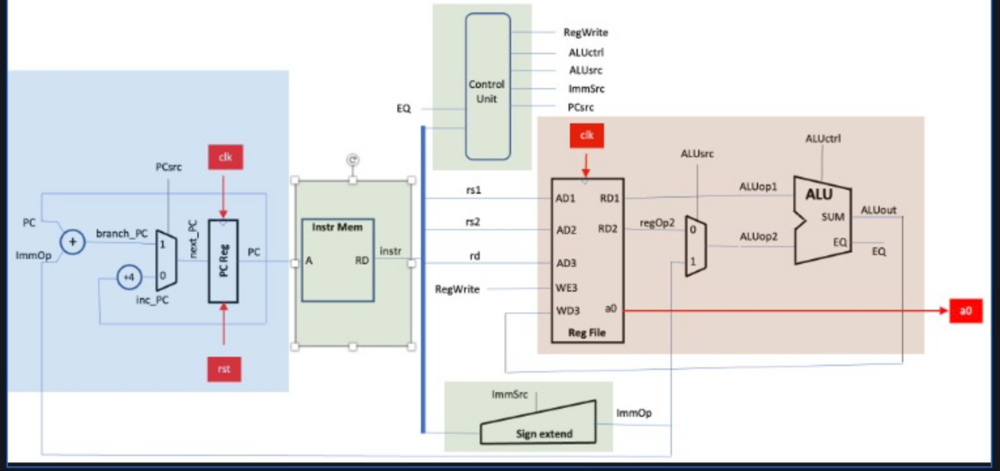

# PC_logic

This folder contains .sv files to synthesise the PC_logic segment (highlighted in blue):

`riscv_pc.sv` is the hierarchial PC module.

`pc_reg.sv` and `pc_counter.sv` are individual modules that are included in `riscv_pc.sv`.

`pc_reg.sv` and `pc_counter.sv` can be parameterised.

