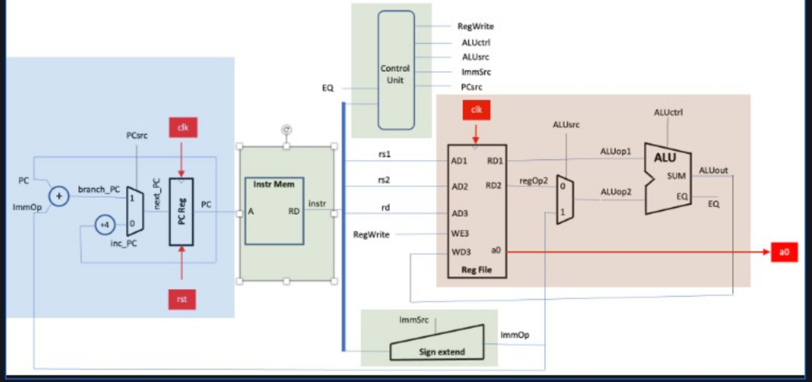

This folder contains a .sv file to synthesise the Instr_Mem segment(highlighted in green):

`Instr_mem.sv` is a ROM memory module, it uses byte-addressing (each address is a byte, 256 addresses)

`program.hex` is a file containing relevant hexadecimal inputs for the ROM memory module so save in each byte address.

